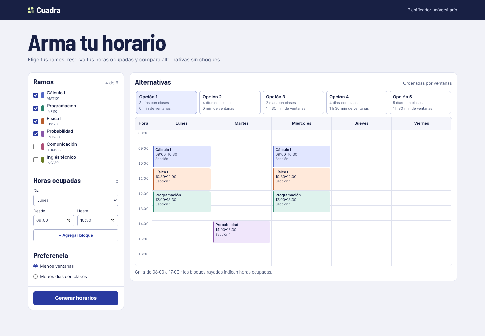

# Cuadra · Generador de horarios universitarios

Cuadra elige una sección por ramo y devuelve hasta cinco horarios sin choques. Permite bloquear horas, priorizar menos ventanas o menos días con clases, y comparar las alternativas en una grilla semanal.

[Demo interactiva en GitHub Pages](https://humiumii.github.io/generador-horarios/) · [Decisiones de diseño](DESIGN.md)

La demo pública usa el catálogo ficticio de seis ramos y evalúa sus combinaciones en el navegador. La versión completa ejecuta el motor Python con OR-Tools CP-SAT a través de FastAPI.



## Ejecutar la versión completa

Se requiere Python 3.13 o 3.14 y Node.js 24. Ejecuta estos comandos desde la raíz del repositorio.

```bash
python -m venv .venv
source .venv/bin/activate
python -m pip install -r requirements-dev.txt
npm --prefix web ci
npm --prefix web run build
python -m uvicorn scheduler.api:app --port 8765
```

En PowerShell, usa `.\.venv\Scripts\Activate.ps1` para activar el entorno. Abre [Cuadra en local](http://127.0.0.1:8765/) o la [documentación de FastAPI](http://127.0.0.1:8765/docs). Para editar la interfaz con recarga, deja Uvicorn activo y ejecuta `npm --prefix web run dev`.

## Ejemplo reproducible

1. Abre la app con los cuatro ramos precargados. La primera alternativa de **Menos ventanas** tiene 3 días con clases y 0 min de ventanas.
2. Elige **Menos días con clases** y pulsa **Generar horarios**. La primera alternativa tiene 2 días con clases y 1 h 30 min de ventanas.
3. Agrega un bloque de 09:00 a 10:30 el lunes y otro el martes. Pulsa **Generar horarios**. Esos bloques descartan las dos secciones de Cálculo I, así que aparece el estado sin solución.

La API expone `GET /api/catalog` y `POST /api/schedules`. Los días se codifican del 0 (lunes) al 4 (viernes) y las horas en minutos desde medianoche.

```bash
curl -X POST http://127.0.0.1:8765/api/schedules \
  -H 'Content-Type: application/json' \
  -d '{"courses":["MAT101","INF110","FIS120","EST200"],"preference":"days","unavailable":[]}'
```

## Cómo funciona el motor

- Cada sección tiene una variable booleana. Para cada ramo, exactamente una variable vale 1. Los bloques de una sección se seleccionan juntos.
- Dos secciones con un cruce son mutuamente excluyentes. Una sección que cruza un bloque ocupado se descarta. Los intervalos son semiabiertos `[inicio, término)`, por lo que dos clases contiguas son compatibles.
- Para cada día con clases, las ventanas son el término de la última clase menos el inicio de la primera, descontando todos los minutos lectivos. Los días sin clases aportan cero minutos.
- El objetivo prioritario se pondera por encima del máximo del objetivo secundario. Tras cada solución óptima se excluye esa combinación de secciones y se vuelve a optimizar, hasta reunir cinco o agotar las soluciones.

El motor está en `scheduler/engine.py`, el contrato HTTP en `scheduler/api.py` y la interfaz en `web/`. Ambos modos comparten `catalog.json`.

## Verificación y despliegue

```bash
python -m pytest -q
npm --prefix web run build
npm --prefix web run build:demo
```

GitHub Actions ejecuta las pruebas y despliega el build de ejemplo desde `web/dist-demo`. Para desplegar la versión completa en Render, conecta el repositorio y usa su Blueprint `render.yaml`. La imagen reúne la interfaz y FastAPI en un solo servicio. También se puede ejecutar con Docker.

```bash
docker build -t cuadra .
docker run --rm -p 8765:8765 cuadra
```
